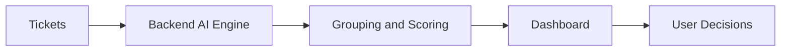
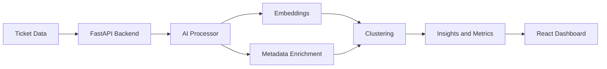

# Simplified Architecture Story For Demo

## Simple story

This product has two parts:

- a dashboard people interact with
- an AI engine behind the scenes that reads tickets and groups similar incidents together

## The easiest way to explain it live

### 1. Tickets come in

The system starts with support or operational tickets.

These tickets can come from:

- demo JSON data right now
- later from tools like Jira, Slack, or support systems

### 2. The backend becomes the “brain”

The FastAPI backend takes every ticket and runs an AI pipeline on it.

That pipeline:

- reads the title and description
- understands the meaning using embeddings
- identifies broad category and symptom
- creates smarter dynamic labels
- groups similar incidents into clusters

### 3. The AI finds patterns, not just keywords

So instead of treating tickets as unrelated lines of text, it can figure out:

- these five tickets are all the same underlying issue
- this cluster is growing quickly
- this one is high risk
- this one is likely a duplicate

### 4. The backend converts patterns into business signals

After clustering, the system computes:

- impact score
- confidence score
- trend direction
- top recurring issue
- recommended action

That is what turns raw ticket noise into operational intelligence.

### 5. The dashboard shows the result

The React frontend calls the backend APIs and displays:

- top KPIs
- cluster cards
- severity and trend charts
- duplicate detection
- all tickets with cluster assignments
- Jira draft generation

## Demo version of the architecture

## Slightly richer version

## Best talk track for a stakeholder demo

You can say:

“On the left, we ingest raw incidents. In the middle, the AI layer understands what each ticket means, groups similar issues, and scores what matters most. On the right, the dashboard turns that into clusters, trends, and actions so operations teams can prioritize faster.”

## Best talk track for a technical demo

You can say:

“The backend runs a hybrid clustering pipeline using semantic embeddings plus metadata like category, symptom, and severity. That produces clusters, confidence, trends, and recommended actions, which are then served through FastAPI to the React dashboard.”

## The one-line takeaway

This architecture is basically:

**raw incidents in → AI triage engine in the middle → prioritized operational insight out**

