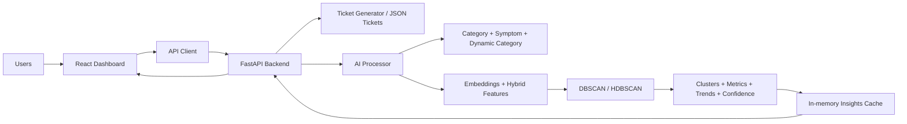

# One-Page Architecture Slide

## Operational Intelligence Dashboard

### What it is

AI-assisted incident triage platform that converts raw support tickets into clustered operational insights, trends, risk signals, and recommended actions.

### Architecture

### Core building blocks

- Frontend: React, Vite, Tailwind, Axios, Recharts
- Backend: FastAPI, Pydantic
- AI/ML: Sentence Transformers, DBSCAN/HDBSCAN, PCA, similarity scoring
- Data: `poc_tickets.json`, `ground_truth.py`, runtime in-memory cache

### End-to-end flow

1. Load tickets from `poc_tickets.json`
2. Enrich each ticket with broad category, symptom, and dynamic category
3. Normalize text and generate semantic embeddings
4. Build hybrid features using text + metadata
5. Cluster related incidents with DBSCAN/HDBSCAN
6. Compute confidence, trends, impact score, keywords, and summaries
7. Serve results to the React dashboard through REST APIs

### Key outputs

- Incident clusters
- Duplicate detection
- Cluster confidence
- Trend tracking
- Risk score and KPIs
- Jira draft generation
- Manual ticket and cluster operations

### Current POC constraints

- No persistent database
- In-memory cache only
- Backend restart resets runtime mutations
- No auth / RBAC layer yet

### Why this architecture works

- Explainable AI, not black-box LLM behavior
- Lightweight enough for demos
- Modular enough to extend toward Jira/Slack ingestion and production persistence

