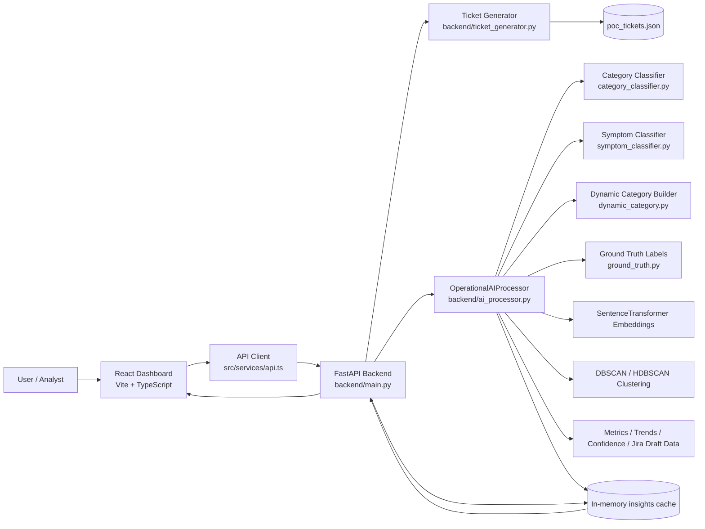
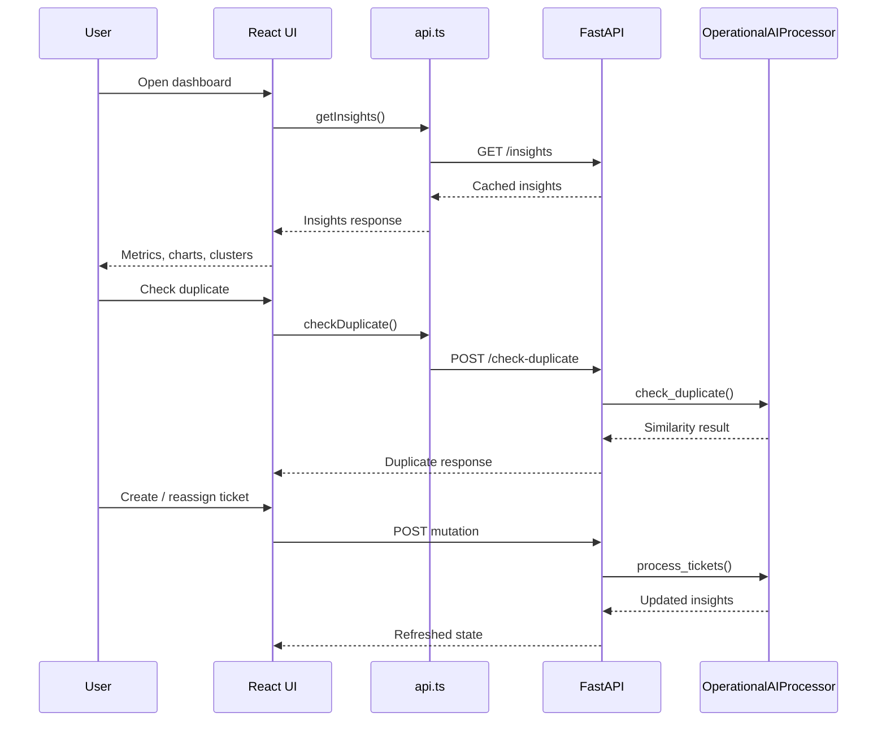
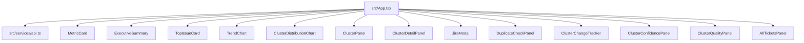
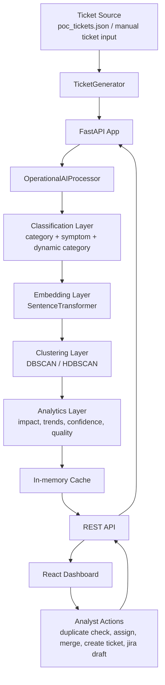

# Operational Intelligence Dashboard Architecture

## 1. Project overview

This project is an AI-assisted incident triage dashboard.

It has two main layers:

- A `FastAPI` backend that loads ticket data, runs the AI clustering pipeline, computes metrics, and exposes APIs.
- A `React + Vite` frontend that consumes those APIs and visualizes incident patterns, cluster insights, duplicate checks, and operational actions.

At runtime, the backend acts as the intelligence layer and the frontend acts as the presentation and interaction layer.

---

## 2. High-level architecture



---

## 3. Backend architecture

### Core modules

- `backend/main.py`
  - application entry point
  - defines FastAPI routes
  - runs AI processing at startup
  - stores `demo_tickets`, `insights_cache`, and `cluster_names` in memory

- `backend/ai_processor.py`
  - main intelligence engine
  - normalizes ticket text
  - computes embeddings
  - enriches tickets with category and symptom metadata
  - builds hybrid features
  - clusters tickets
  - computes confidence, trends, metrics, and summaries

- `backend/ticket_generator.py`
  - loads demo tickets
  - prefers `backend/poc_tickets.json`
  - falls back to built-in sample tickets if JSON is unavailable

- `backend/config.py`
  - central runtime configuration
  - clustering thresholds
  - model names
  - feature weights
  - normalization mode
  - category mode

- `backend/category_classifier.py`
  - assigns broad taxonomy categories
  - can use semantic similarity or LLM-backed classification

- `backend/symptom_classifier.py`
  - infers finer symptom patterns such as timeout, stuck progress, data corruption, or access error

- `backend/dynamic_category.py`
  - creates more adaptive category labels from topic + symptom
  - preserves broad taxonomy separately

- `backend/ground_truth.py`
  - contains evaluation labels for clustering quality analysis

### Backend processing flow

```mermaid
flowchart TD
    S[FastAPI startup] --> L[Load tickets]
    L --> J{poc_tickets.json exists?}
    J -->|Yes| P[Load JSON tickets]
    J -->|No| T[Use built-in TEST_TICKETS]

    P --> PR[process_tickets()]
    T --> PR

    PR --> SYM[Add symptom labels]
    SYM --> CAT[Add taxonomy category labels]
    CAT --> DYN[Build dynamic categories]
    DYN --> NORM[Normalize text]
    NORM --> EMB[Generate embeddings]
    EMB --> HF[Build hybrid features<br/>text + category + symptom + severity]
    HF --> CLUST[DBSCAN / HDBSCAN clustering]
    CLUST --> CONF[Compute cluster confidence]
    CONF --> ENRICH[Add summaries, actions, keywords]
    ENRICH --> TREND[Compute trends and change tracking]
    TREND --> QUAL[Compute quality metrics]
    QUAL --> CACHE[Store insights_cache in memory]
```

### AI pipeline details

The processor combines several layers of intelligence:

1. `Semantic understanding`
   - ticket title and description are converted into embeddings using `SentenceTransformer`

2. `Metadata enrichment`
   - broad taxonomy category
   - symptom classification
   - dynamic category generation
   - severity normalization

3. `Hybrid clustering`
   - embedding vectors remain the strongest signal
   - category, symptom, and severity are added as light metadata features
   - DBSCAN or HDBSCAN groups similar issues into clusters

4. `Insight generation`
   - cluster summary
   - impact score
   - recommended action
   - priority level
   - business impact
   - confidence score
   - top keywords

5. `Operational analytics`
   - recent vs previous 7-day comparison
   - trend direction
   - cluster change states
   - global risk score
   - clustering quality metrics

---

## 4. API architecture

The backend exposes three main API groups.

### Read APIs

- `GET /`
- `GET /tickets`
- `GET /tickets/search`
- `GET /tickets-with-clusters`
- `GET /insights`
- `GET /cluster/{cluster_id}`
- `GET /config`
- `GET /clusters/names`

### AI / triage APIs

- `POST /check-duplicate`
- `POST /assign-cluster`
- `POST /jira-draft/{cluster_id}`

### Mutation / manual-ops APIs

- `POST /tickets`
- `POST /clusters/assign`
- `POST /clusters/merge`
- `POST /clusters/name`
- `POST /clusters/bulk-assign`
- `POST /clusters/unassign`

### API interaction pattern



---

## 5. Frontend architecture

### Core frontend files

- `src/App.tsx`
  - main container
  - loads insights on startup
  - owns active tab, selected cluster, and jira modal state

- `src/services/api.ts`
  - API abstraction for backend communication
  - defines TypeScript interfaces for responses

- `src/components/*`
  - focused presentation components for charts, panels, cards, tables, and workflows

### Main UI areas

- `Overview`
  - top metrics
  - executive summary
  - trend charts
  - cluster distribution
  - top issue cards

- `Check Duplicate`
  - search assistance
  - semantic duplicate detection

- `Cluster Changes`
  - recent/new/increasing/decreasing/resolved views

- `Cluster Confidence`
  - cluster confidence and quality visibility

- `All Tickets`
  - ticket inventory
  - assignment and manual actions

### Frontend component diagram



---

## 6. Data architecture

This project currently uses file-backed demo data plus in-memory application state.

### Current data sources

- `backend/poc_tickets.json`
  - primary incident dataset

- `backend/ground_truth.py`
  - evaluation labels for clustering quality

- `backend/config.py`
  - configuration source from environment variables

### Runtime state

- `demo_tickets`
  - active working set of tickets

- `insights_cache`
  - processed AI output returned by the UI

- `cluster_names`
  - manual display labels for clusters

### Important note

There is no persistent database yet.

That means:

- mutations are memory-based
- restarting the backend resets runtime changes
- this is currently a POC architecture, not a production persistence architecture

---

## 7. End-to-end architecture summary



---

## 8. Architectural assessment

### What is strong

- clean separation between backend intelligence and frontend visualization
- explainable AI pipeline rather than black-box output
- modular classification and clustering layers
- easy to demo and iterate because everything is file-backed and lightweight
- good POC shape for operational triage and incident clustering

### Current limitations

- no persistent database
- in-memory cache only
- single-process backend state
- no authentication or authorization on APIs
- no background job queue
- model loading depends on local environment and network/model cache

### Natural next evolution

- add database persistence
- move ticket ingestion to external systems like Jira or Slack
- add async/background processing for model-heavy tasks
- persist cluster actions and audit trail
- introduce authentication and role-based access
- deploy backend and frontend as separate services behind an API gateway

